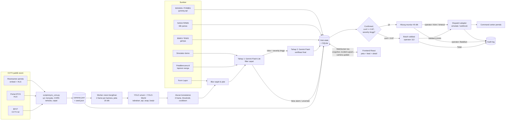
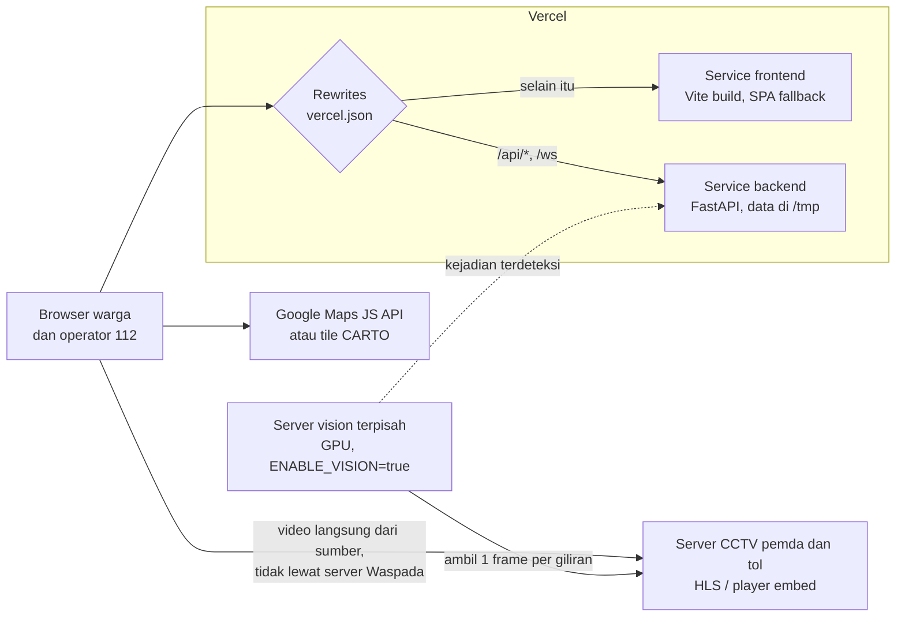

# Waspada Nusantara

Peta real-time kondisi darurat Indonesia. Satu layar menampilkan semua peringatan aktif (karhutla, banjir, gempa, longsor, kecelakaan, gunung api, kriminal), deteksi otomatis dari CCTV publik dengan computer vision, verifikasi AI dua tahap untuk menekan false alarm, dan alur dispatch ke command center 112 dengan operator tetap memegang keputusan.

Demo berjalan penuh **tanpa API key apa pun**. Versi online berjalan di Vercel (lihat [Deploy ke Vercel](#deploy-ke-vercel)).

---

## Cara menjalankan

Butuh Node 20+ dan Python 3.11+.

### Cara cepat (satu perintah)

```bash
cd waspada
./dev.sh
```

Skrip ini membuat venv dan `npm install` bila belum ada, lalu menyalakan backend (port 8000) dan frontend (port 5173). Buka `http://localhost:5173`. Tekan Ctrl+C untuk mematikan keduanya.

Atau jalankan manual di dua terminal:

### 1. Backend (FastAPI + WebSocket)

```bash
cd backend
python3 -m venv .venv
.venv/bin/pip install -r requirements.txt
cp .env.example .env          # opsional, semua nilai boleh kosong
.venv/bin/uvicorn app.main:app --reload --port 8000
```

### 2. Frontend (React + Vite)

```bash
cd frontend
npm install
cp .env.example .env          # opsional
npm run dev                   # http://localhost:5173
```

Vite mem-proxy `/api` dan `/ws` ke `http://127.0.0.1:8000`. Kalau backend mati, frontend tetap tampil dengan seed data, simulator lokal, dan banner "Mode offline".

### Alur demo untuk juri (2 menit)

1. Buka `http://localhost:5173`. Peta Indonesia langsung tampil dengan semua peringatan. Indikator **LIVE** di top bar.
2. Tunggu 20 sampai 30 detik: simulator memunculkan kejadian baru, toast muncul untuk kejadian kritis.
3. Atau klik **Picu kejadian demo** di panel Layer: kejadian kritis dari CCTV muncul, status "Diverifikasi AI...", lalu terverifikasi.
4. Buka halaman operator 112 di `http://localhost:5173/operator`. Kontrol dispatch hanya ada di sini; halaman publik hanya melihat status "petugas sudah diberitahu". Klik toast atau item feed: peta terbang ke lokasi, panel berganti ke detail berisi hasil verifikasi AI (verdict, confidence, alasan, model).
5. Kepastian AI **87% atau lebih**: **hitung mundur 112** otomatis, operator bisa **Kirim sekarang** atau **Batalkan**, tanpa aksi terkirim saat hitung mundur habis. **Di bawah 87%**: status **Butuh validasi**, tidak ada timer dan tidak pernah terkirim sendiri, operator harus **Validasi & kirim** atau **Tolak** (contoh: Tol Palindra, 82%). Semua keputusan tercatat di `GET /api/audit`.
   Di atas tombol validasi ada panel **Bukti pendukung**: indikator otomatis (mendukung atau melemahkan), kondisi lokasi (suhu, kelembapan, angin, hujan sekarang dan 24 jam, kualitas udara AQI dan PM2.5, ketinggian), siaran langsung CCTV pendeteksi atau terdekat, rekaman frame saat deteksi, dan kejadian lain dalam 15 km.
6. Buka **dashboard operator** di `http://localhost:5173/operator/dashboard` (tombol **Dashboard** di top bar operator). Tiga kolom: **antrean kerja** (tab Validasi, Hitung mundur, Laporan warga, Semua aktif, Riwayat, dengan cari, filter, dan aksi massal), **ruang kerja** (panel **Kenapa terindikasi**: deteksi, verifikasi AI dengan bar kepastian vs ambang, dan aturan otomasi yang menentukan jalurnya, ditambah bukti pendukung, keputusan dispatch, kirim manual ke 112, tutup kejadian sebagai ditangani/false alarm/duplikat, dan catatan operator), serta **log aktivitas** live (filter pelaku, ekspor CSV). Tombol **Otomasi** mengatur ambang auto-dispatch, lama hitung mundur, ambang sembunyi false alarm, wajib validasi laporan warga, dan gempa BMKG M6+, lengkap dengan simulasi dampaknya. Pintasan: `J`/`K` pindah kejadian, `/` cari. Endpoint baru: `POST /api/incidents/{id}/resolve`, `/notes`, `/dispatch/manual`, `GET/PUT /api/automation`.
7. **Warga terhubung ke operator.** Setelah melapor, tombol **Laporan saya** muncul di top bar. Pelapor melihat perjalanan laporannya (diterima, dicek sistem, ditinjau operator 112, petugas diberitahu, selesai), menerima notifikasi saat operator mengirim kabar, dan bisa membalas. Di dashboard, operator memilih jenis pesan: **Internal** (hanya operator), **Pembaruan publik** (tampil di detail kejadian peta publik dan di Laporan saya), atau **Tanya pelapor** (khusus laporan dari aplikasi). Balasan pelapor ditandai **Pelapor membalas** di antrean dan log. Hanya pelapor yang memegang token laporan (tersimpan di browsernya) yang bisa membalas, lewat `POST /api/reports/{id}/reply`. Halaman publik menyambung ke `/ws` tanpa catatan internal; halaman operator memakai `/ws?role=operator`.
8. Klik **Lapor** untuk mengirim laporan warga (jenis, deskripsi, lokasi dari peta atau GPS, foto opsional).
9. Saat peta di-zoom jauh, CCTV tampil sebagai satu penanda per kota berisi jumlah kamera. Klik penanda itu untuk zoom ke kota tersebut, lalu klik marker **LIVE** untuk menonton CCTV resmi secara langsung. Di halaman operator, tombol **Video wall** menampilkan grid CCTV live per kota (6 per halaman).

### CCTV live dari sumber resmi

Kamera live diambil hanya dari siaran yang dibuka instansi untuk publik, tanpa token, login, atau menembus pembatasan. Sumbernya didaftarkan di `backend/cctv_sources.json`, lalu `scripts/sync_cctv.py` menguji setiap kamera: harus menyala, servernya mengizinkan diputar dari situs lain (CORS terbuka), dan cukup cepat ditonton (satu segmen video terunduh lebih cepat dari durasi putarnya). Kamera yang gagal diuji ulang sekali.

| Jenis sumber | Kunci config | Daerah saat ini |
|---|---|---|
| CCTV jalan tol dari daftar resmi BPJT Kementerian PU (`bpjt.pu.go.id/cctv`), difilter per area (bbox) | `toll_pages` | Jakarta (JORR S, Akses Tanjung Priok, JORR W1, Dalam Kota Kelapa Gading-Pulo Gebang, Becakayu) |
| Stream HLS dari portal ATCS yang mencantumkan alamat video di halamannya | `hls_pages` | Banjarbaru, Ciamis, Pekanbaru (masuk kalau servernya cukup cepat) |
| Server Restreamer pemda dengan player embed resmi (oEmbed). Ditonton lewat player resmi, dibaca computer vision lewat HLS-nya (`vision_url`) | `restreamers` | Banda Aceh, Kota Magelang, Pati |
| YouTube resmi pemda dan BPBD | `channels` | Dimatikan (`enable_youtube: false`), tidak boleh diproses computer vision |
| Link portal resmi yang tidak bisa di-embed | `portals` | Dimatikan (`enable_portals: false`) |

Hasil sync terakhir: sekitar 230 kamera live di 6 kota (Jakarta 85, Banjarbaru 50, Banda Aceh 41, Kota Magelang 31, Ciamis 19, Pati 4). Jumlahnya berubah tergantung kamera yang menyala dan kecepatan server pemda saat diuji.

Sumber yang tidak dipakai karena servernya mengunci akses ke domain sendiri: Pelindung Bandung, tol Jasa Marga, Banjarmasin, Banyumas. Untuk memakainya perlu izin pemilik kamera (domain Waspada ditambahkan ke daftar yang diizinkan).

Perbarui sebelum demo, lalu commit hasilnya:

```bash
cd backend && .venv/bin/python scripts/sync_cctv.py   # tulis ulang cameras.json dan shared/seed.json
```

Menambah area tol baru cukup dengan menambah item `areas` (nama kota, bbox `[selatan, barat, utara, timur]`, titik tengah) di `toll_pages`.

Kejadian simulasi tidak pernah ditempel ke CCTV asli, hanya ke kamera demo. Kejadian di CCTV asli hanya datang dari pipeline computer vision (lihat di bawah).

---

## Environment variables

| Variabel | Default | Keterangan |
|---|---|---|
| **Frontend** | | |
| `VITE_GOOGLE_MAPS_API_KEY` | kosong | Kosong = fallback Leaflet + tile gelap |
| `VITE_GOOGLE_MAP_ID` | kosong | Map ID vector (dark). Kosong = `DEMO_MAP_ID` |
| `VITE_TILE_URL` | CARTO `dark_all` | Tile untuk fallback Leaflet (gratis tanpa key, jalan di domain publik) |
| **Backend** | | |
| `LLM_PROVIDER` | `gemini` | `gemini` atau `anthropic` |
| `GEMINI_API_KEY` | kosong | Key gratis dari Google AI Studio. Kosong = verifier heuristik berlabel "simulasi" |
| `GEMINI_TRIAGE_MODEL` | `gemini-flash-lite-latest` | Tahap 1, filter cepat |
| `GEMINI_VERIFY_MODEL` | `gemini-flash-latest` | Tahap 2, verifikasi final |
| `VERIFY_EFFORT` | `low` | `low` atau `medium` (Gemini: thinking level) |
| `ANTHROPIC_API_KEY` | kosong | Dipakai kalau `LLM_PROVIDER=anthropic` |
| `TRIAGE_MODEL` / `VERIFY_MODEL` | `claude-haiku-5-5` / `claude-opus-5-5` | Model Claude untuk tahap 1 dan 2 |
| `NASA_FIRMS_MAP_KEY` | kosong | Titik panas satelit. Kosong = sumber FIRMS nonaktif |
| `DISPATCH_MODE` | `simulate` | `simulate` atau `webhook` |
| `DISPATCH_WEBHOOK_URL` | kosong | Endpoint command center (mode webhook) |
| `DISPATCH_COUNTDOWN_S` | `45` | Lama hitung mundur |
| `DISPATCH_CONFIDENCE_MIN` | `0.87` | Ambang auto-dispatch. Di bawahnya wajib divalidasi operator 112 |
| `DEMO_MODE` | `true` | Seed data + simulator + tombol demo |
| `ENABLE_BMKG` / `ENABLE_PETABENCANA` / `ENABLE_MAGMA` | `true` | Sumber data nyata gratis tanpa key |
| `ENABLE_VISION` | `false` | Pipeline CCTV + YOLO (butuh `requirements-vision.txt`) |
| `VISION_SAMPLE_S` | `20` | Jeda minimal per kamera (detik) |
| `VISION_CONCURRENCY` | `3` | Kamera yang diproses bersamaan |
| `VISION_CITIES` | kosong | Batasi ke kota tertentu, misal `Banjarbaru,Ciamis`. Kosong = semua |
| `VISION_MAX_CAMERAS` | `0` | Batas jumlah kamera. `0` = tanpa batas |
| `GENERAL_WEIGHTS` | `yolo11n.pt` | YOLO umum (kendaraan, orang) |
| `WORLD_WEIGHTS` | `yolov8s-worldv2.pt` | YOLO-World untuk api, asap, banjir. Kosong = mati |
| `FIRE_WEIGHTS` | `weights/fire_smoke.pt` | Weights kustom api/asap (opsional) |

Jangan commit file `.env`. Sudah masuk `.gitignore`.

---

## Arsitektur

### Alur data



### Deploy dan jalur video



- **Video tidak melewati server Waspada.** Browser memutar HLS atau player embed langsung dari server pemda, jadi Vercel tidak menanggung bandwidth video.
- **Computer vision tidak bisa di Vercel** (terlalu berat untuk serverless). Jalankan backend dengan `ENABLE_VISION=true` di laptop, PC, atau server dengan GPU. Garis putus-putus di diagram adalah rencana production: saat ini server vision menjalankan backend lengkapnya sendiri.
- **Peta ringan:** saat zoom jauh, kamera digabung per kota (`frontend/src/lib/cameraLayout.ts`). Saat zoom dekat, hanya kamera yang terlihat di layar yang digambar. Marker memakai latar solid tanpa blur.

### Struktur folder

```
waspada/
  vercel.json          deploy multi-service: service frontend + backend, rewrites /api dan /ws
  dev.sh               jalankan backend + frontend lokal sekaligus
  frontend/            React + Vite + TS, Tailwind v4, motion, Google Maps / Leaflet
    src/map/           GoogleMapView, LeafletMapView, Controller (fokus + zoom), CameraLayer
    src/map/markers/   IncidentMarker, CameraMarker, CameraClusterMarker (gabungan per kota), PickedMarker
    src/components/    TopBar, LayerPanel, IncidentPanel, IncidentFeed, IncidentDetail, EvidencePanel,
                       DispatchTimeline, CameraPlayer, CameraViewer, VideoWall, BottomSheet, Toasts,
                       Legend, ReportForm
    src/store/         useLiveData: snapshot + WebSocket + fallback offline
    src/lib/           meta bahaya, sort, seed, bounds, camera, cameraLayout, mesin lokal (mode offline)
  backend/
    app/sources/       base.py (interface DataSource), bmkg, firms, petabencana, magma, demo_seed
    app/llm/           schema (structured output), context (cuaca, laporan terdekat), verifier, heuristic
    app/dispatch/      base, simulate, webhook, manager (hitung mundur + audit)
    app/vision/        pipeline (worker bergiliran, YOLO + YOLO-World), privacy (blur)
    app/simulator.py   kejadian baru tiap 20-30 detik (hanya di kamera demo)
    app/pipeline.py    kandidat -> verifikasi -> audit -> dispatch
    app/config.py      pengaturan dari env; di Vercel data ditulis ke /tmp/waspada
    cameras.json       daftar kamera (dihasilkan scripts/sync_cctv.py + kamera demo)
    cctv_sources.json  sumber CCTV resmi: toll_pages, hls_pages, restreamers, channels, portals
    geocode_cache.json cache lokasi OpenStreetMap Nominatim untuk kamera tanpa koordinat
    scripts/sync_cctv.py  ambil, uji, dan tulis CCTV live dari sumber resmi
  shared/seed.json     data demo (dipakai frontend dan backend)
  design-system/       hasil ui-ux-pro-max (MASTER.md)
```

### API

| Endpoint | Fungsi |
|---|---|
| `GET /api/snapshot` | Semua kejadian, zona, rute, kamera |
| `WS /ws` | Snapshot saat connect, lalu `incident.upsert`, `camera.update`, `heartbeat` |
| `POST /api/incidents/{id}/dispatch/confirm` | Operator: kirim sekarang |
| `POST /api/incidents/{id}/dispatch/cancel` | Operator: batalkan |
| `POST /api/reports` | Laporan warga (multipart: `type`, `description`, `lat`, `lng`, `photo` opsional) |
| `GET /api/incidents/{id}/evidence` | Bukti untuk operator: kondisi lokasi (Open-Meteo), kejadian sekitar, kamera, frame deteksi |
| `GET /api/audit` | Audit log keputusan AI dan operator |
| `GET /api/frames/{name}` | Frame bukti deteksi CCTV (sudah diblur) |
| `POST /api/demo/trigger` | Mode demo: buat kejadian kritis CCTV sekarang |
| `GET /api/health` | Status server |

### Deploy ke Vercel

Repo ini di-deploy sebagai satu project Vercel dengan dua service (`vercel.json`):

| Service | Root | Isi |
|---|---|---|
| `frontend` | `frontend/` | Build Vite. Semua path diarahkan ke `index.html` supaya `/operator` tidak 404 |
| `backend` | `backend/` | FastAPI `app.main:app`. Saat build, `shared/seed.json` disalin ke `backend/shared/` |

Rewrites: `/api/*` dan `/ws` ke backend, sisanya ke frontend. Browser memanggil `/api` di domain yang sama, jadi tidak perlu binding tambahan.

- Set `VITE_GOOGLE_MAPS_API_KEY` di Vercel sebagai env var tipe **Config**, bukan Secret (variabel `VITE_` dibaca saat build, jadi perlu redeploy setelah diubah). Batasi key di Google Cloud Console ke domain production.
- Fungsi serverless Vercel tidak mendukung WebSocket, jadi `/ws` mengembalikan 404. Frontend mendeteksinya: kalau WebSocket gagal tapi `/api/snapshot` hidup, data diambil lewat HTTP tiap 20 detik (status tetap **Live**, tanpa banner offline). Karena state backend tidak dibagi antar instance, simulator, hitung mundur, dan aksi operator/laporan di mode ini diproses di browser. Banner "Mode offline" hanya muncul kalau API juga tidak terjangkau.
- Di Vercel hanya `/tmp` yang bisa ditulis. Database dan frame bukti disimpan di `/tmp/waspada`, dan state backend hanya bertahan per instance. Untuk production, pindahkan ke database terkelola.

---

## Sumber data

| Sumber | Status | Catatan |
|---|---|---|
| BMKG TEWS (`autogempa.json`, `gempaterkini.json`) | Aktif, tanpa key | Gempa 72 jam terakhir. M >= 6 langsung masuk hitung mundur |
| NASA FIRMS (VIIRS S-NPP, NOAA-20, NOAA-21, MODIS) | Butuh `NASA_FIRMS_MAP_KEY` gratis | Dicek tiap 10 menit. Titik mentah 48 jam terakhir jadi heatmap kebakaran (bobot FRP, memudar seiring waktu). Kluster per grid 0,1 derajat jadi kejadian di peta. Tanpa key, heatmap memakai data contoh |
| PetaBencana.id | Aktif, tanpa key | Laporan warga 24 jam terakhir, lewat verifier |
| MAGMA Indonesia (PVMBG) | Aktif, parsing halaman | Tidak ada API JSON resmi. Gunung Level III dan IV + radius larangan perkiraan. Gagal = pakai seed |
| Kriminal | Data demo | Tidak ada API terbuka. Area rawan berupa polygon agregat dengan label sumber dan periode |
| Cuaca (Open-Meteo) | Aktif, tanpa key | Konteks tambahan untuk verifier |

Data seed diberi label "data demo" di UI. Kejadian dari simulator diberi label "(simulasi)".

---

## Verifikasi AI (anti false alarm)

Provider default adalah Google Gemini (`LLM_PROVIDER=gemini`), dipanggil langsung lewat REST `generateContent` tanpa SDK tambahan (`app/llm/gemini.py`). Claude tetap tersedia dengan `LLM_PROVIDER=anthropic`.

- **Tahap 1** `GEMINI_TRIAGE_MODEL` (Gemini Flash-Lite, thinking low): semua kandidat dari CCTV, laporan warga, dan simulator.
- **Tahap 2** `GEMINI_VERIFY_MODEL` (Gemini Flash, thinking `VERIFY_EFFORT`): hanya kandidat yang lolos tahap 1 dengan severity tinggi/kritis.
- Input: 2 sampai 4 frame berurutan (sudah diblur) + konteks lokasi, jam WIB, cuaca, kejadian dan laporan dalam radius 15 km.
- Output wajib JSON terstruktur (`responseSchema`): `verdict`, `confidence`, `severity`, `reasoning` (Bahasa Indonesia), `recommended_agency`.
- Diblokir filter keamanan, output terpotong, kuota habis, dan semua error API menghasilkan verdict `uncertain` + "butuh cek manual". Kejadian tidak pernah hilang.
- False alarm dengan confidence >= 0,7 disembunyikan dari peta tapi tetap tersimpan di database dan audit log.
- Tanpa API key: verifier heuristik, selalu berlabel **simulasi** di UI.

## Integrasi 112

Belum ada API publik untuk 112 Indonesia. Layanan 112 dikelola pemda (command center) bersama Komdigi, dan panggilan otomatis dari AI tanpa pengecekan berisiko membanjiri operator dengan false alarm. Karena itu:

- **Kode ini tidak pernah menelepon 112.** Adapter `simulate` (default) hanya mencatat payload. Adapter `webhook` mengirim JSON ke endpoint command center yang dikonfigurasi.
- **Halaman operator** (`/operator`): satu-satunya tempat kontrol dispatch. Antrean diurutkan: butuh validasi, lalu hitung mundur, lalu severity.
- **Auto-dispatch**: severity tinggi/kritis + verdict confirmed + confidence >= 0,87 memulai hitung mundur 45 detik. Operator bisa Kirim sekarang atau Batalkan. Tanpa aksi, terkirim otomatis.
- **Validasi operator**: severity tinggi/kritis dengan confidence di bawah 0,87 (atau verdict uncertain) masuk status `review`. Tidak ada timer; hanya terkirim kalau operator menekan Validasi & kirim, atau ditutup dengan Tolak.
- Payload (`waspada.dispatch.v1`): jenis, koordinat, alamat, waktu, ringkasan AI, link frame bukti, instansi yang direkomendasikan, siapa yang memutuskan.
- Semua keputusan AI, sistem, dan operator tercatat di tabel `audit_log` (`GET /api/audit`).

Tombol **Hubungi 112** di top bar adalah tautan `tel:112` untuk warga.

## Pipeline CCTV + computer vision

Aktifkan dengan `ENABLE_VISION=true` dan `pip install -r requirements-vision.txt`. Paket ini ikut memasang PyTorch (beberapa GB). YOLO-World akan memasang paket `clip` dan mengunduh weights-nya sendiri saat pertama jalan. Pipeline ini butuh mesin dengan CPU/GPU kuat, jadi jalankan backend di laptop atau server sendiri, bukan di Vercel.

Kamera yang diproses: semua kamera ATCS hasil `scripts/sync_cctv.py` (HLS langsung, atau HLS di balik player embed lewat `vision_url`) plus kamera yang ditambahkan manual. YouTube tidak pernah diproses (dilarang ToS).

- **Ringan untuk server pemda:** tiap giliran hanya 1 frame per kamera, koneksi langsung ditutup. `VISION_CONCURRENCY` worker (default 3) mengunjungi kamera bergiliran, dengan jeda minimal `VISION_SAMPLE_S` detik (default 20) per kamera.
- **Batasi beban laptop:** `VISION_CITIES=Banjarbaru,Ciamis` atau `VISION_MAX_CAMERAS=20`.
- **Model:**
  - YOLO umum (`GENERAL_WEIGHTS`): kendaraan saling tumpang tindih = dugaan tabrakan, banyak orang = kerumunan.
  - YOLO-World (`WORLD_WEIGHTS`, prompt teks): api, asap, banjir/genangan, kendaraan terguling. Tidak perlu training.
  - Weights kustom opsional (`FIRE_WEIGHTS`), misalnya hasil training D-Fire di `backend/weights/fire_smoke.pt`, untuk api/asap yang lebih akurat.
- **Aturan sebelum LLM:** deteksi harus muncul di 3 frame berturut-turut (confidence >= 0,5, atau >= 0,3 untuk api/banjir dari YOLO-World), plus cooldown 10 menit per kamera. Lalu diverifikasi LLM dua tahap dan operator.
- Untuk produksi, ajukan izin tertulis ke Dishub/Diskominfo pemilik kamera.

### Privasi

- Tidak ada face recognition.
- Wajah dan plat nomor diblur sebelum gambar disimpan atau dikirim ke LLM (`app/vision/privacy.py`):
  - Wajah: OpenCV `FaceDetectorYN` bila `backend/weights/face_detection_yunet.onnx` ada (model YuNet dari OpenCV Zoo).
  - Plat: sepertiga bawah kotak kendaraan dari YOLO.
  - Tanpa detektor: gambar diperkecil ke lebar 640 px dan diblur ringan seluruhnya.

---

## Poin pitch

**Masalah.** Informasi bencana di Indonesia lambat menyebar. Saat karhutla, banyak warga tidak tahu ada api atau asap di dekat mereka. Laporan ke 112, damkar, polisi, dan BPBD sering terlambat dan belum terverifikasi, sehingga petugas datang terlambat atau menghabiskan waktu untuk laporan palsu.

**Solusi.** Satu peta Indonesia yang langsung menampilkan semua peringatan aktif dari sumber resmi (BMKG, PVMBG, NASA FIRMS), laporan warga, dan deteksi otomatis CCTV publik. AI memverifikasi setiap kandidat dalam dua tahap sebelum diteruskan, dan kejadian terverifikasi otomatis disiapkan untuk command center 112 dengan operator tetap memegang keputusan akhir.

**Dampak.**
- Waktu dari kejadian ke laporan turun dari menit/jam ke detik (deteksi CCTV + verifikasi otomatis).
- Operator 112 menerima laporan yang sudah terverifikasi, lengkap dengan koordinat, bukti frame, dan instansi yang direkomendasikan.
- Warga melihat rute terhalang, rute berbahaya, zona asap, genangan, dan radius larangan gunung api di satu tempat.
- Jejak audit lengkap untuk akuntabilitas keputusan AI dan manusia.

**Rencana integrasi dengan pemda.**
1. Pilot dengan satu command center (contoh: Jakarta Smart City atau Bandung Command Center) memakai mode `webhook` ke sistem tiket mereka.
2. Kerja sama akses CCTV ATCS/Dishub dengan perjanjian privasi (blur, retensi terbatas, tanpa face recognition).
3. Kalibrasi ambang confidence dan hitung mundur bersama operator 112, ukur false alarm rate per minggu.
4. Skala ke PostgreSQL + PostGIS, antrean pesan, dan penambahan sumber (BNPB/InaRISK, data sensor tinggi muka air).

---

## Catatan teknis

- Peta dikunci di wilayah Indonesia (north 6.8, south -11.8, west 94.0, east 141.8). Zoom minimum dihitung dari ukuran layar supaya seluruh Indonesia muat, zoom maksimum 20 (level jalan).
- Klik pin memakai zoom tujuan sebagai zoom minimum: kalau peta sudah lebih dekat, zoom tidak diubah, hanya digeser ke pin.
- Tile fallback Leaflet default CARTO `dark_all` (gratis tanpa key, jalan di domain publik). Di atas zoom 18 tile diperbesar dari zoom 18. Stadia tidak dipakai karena di domain yang tidak terdaftar hasilnya 401.
- Peta dibuat ringan: kamera digabung per kota saat zoom jauh, hanya kamera di layar yang digambar saat zoom dekat, marker tanpa `backdrop-filter`, callback marker stabil (`memo`) supaya tidak render ulang tiap update realtime. Video wall berlatar solid dan memutar 6 video per halaman.
- Kejadian simulasi selesai otomatis setelah 8 menit dan maksimal 12 aktif sekaligus, supaya peta tidak menumpuk saat demo berjalan lama. Pulse hanya untuk kejadian kritis yang belum ditangani.
- Semua animasi memakai `motion` (`motion/react`) dengan `MotionConfig reducedMotion="user"`; pulse kritis dimatikan saat reduced motion.
- Design system: `design-system/waspada-nusantara/MASTER.md` (ui-ux-pro-max, density 8, motion 5).
