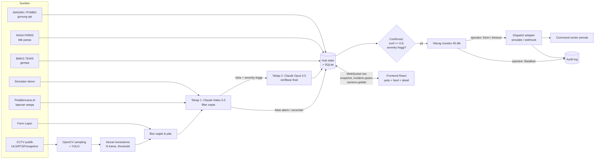

# Waspada Nusantara

Peta real-time kondisi darurat Indonesia. Satu layar menampilkan semua peringatan aktif (karhutla, banjir, gempa, longsor, kecelakaan, gunung api, kriminal), deteksi otomatis dari CCTV publik dengan computer vision, verifikasi AI dua tahap untuk menekan false alarm, dan alur dispatch ke command center 112 dengan operator tetap memegang keputusan.

Demo berjalan penuh **tanpa API key apa pun**.

---

## Cara menjalankan

Butuh Node 20+ dan Python 3.11+.

### Cara cepat (satu perintah)

```bash
cd waspada
./dev.sh
```

Skrip ini membuat venv dan `npm install` bila belum ada, lalu menyalakan backend (port 8000) dan frontend (port 5173). Buka `http://localhost:5173`. Tekan Ctrl+C untuk mematikan keduanya.

Atau jalankan manual di dua terminal:

### 1. Backend (FastAPI + WebSocket)

```bash
cd backend
python3 -m venv .venv
.venv/bin/pip install -r requirements.txt
cp .env.example .env          # opsional, semua nilai boleh kosong
.venv/bin/uvicorn app.main:app --reload --port 8000
```

### 2. Frontend (React + Vite)

```bash
cd frontend
npm install
cp .env.example .env          # opsional
npm run dev                   # http://localhost:5173
```

Vite mem-proxy `/api` dan `/ws` ke `http://127.0.0.1:8000`. Kalau backend mati, frontend tetap tampil dengan seed data, simulator lokal, dan banner "Mode offline".

### Alur demo untuk juri (2 menit)

1. Buka `http://localhost:5173`. Peta Indonesia langsung tampil dengan semua peringatan. Indikator **LIVE** di top bar.
2. Tunggu 20 sampai 30 detik: simulator memunculkan kejadian baru, toast muncul untuk kejadian kritis.
3. Atau klik **Picu kejadian demo** di panel Layer: kejadian kritis dari CCTV muncul, status "Diverifikasi AI...", lalu terverifikasi.
4. Klik toast atau item feed: peta terbang ke lokasi, panel berganti ke detail berisi hasil verifikasi AI (verdict, confidence, alasan, model) dan **hitung mundur 112**.
5. Tekan **Kirim sekarang** atau **Batalkan**. Tanpa aksi, payload terkirim otomatis saat hitung mundur habis. Semua keputusan tercatat di `GET /api/audit`.
6. Klik **Lapor** untuk mengirim laporan warga (jenis, deskripsi, lokasi dari peta atau GPS, foto opsional).

---

## Environment variables

| Variabel | Default | Keterangan |
|---|---|---|
| **Frontend** | | |
| `VITE_GOOGLE_MAPS_API_KEY` | kosong | Kosong = fallback Leaflet + tile gelap |
| `VITE_GOOGLE_MAP_ID` | kosong | Map ID vector (dark). Kosong = `DEMO_MAP_ID` |
| `VITE_TILE_URL` | Stadia `alidade_smooth_dark` | Tile untuk fallback Leaflet |
| **Backend** | | |
| `ANTHROPIC_API_KEY` | kosong | Kosong = verifier heuristik berlabel "simulasi" |
| `TRIAGE_MODEL` | `claude-haiku-5-5` | Tahap 1, filter cepat |
| `VERIFY_MODEL` | `claude-opus-5-5` | Tahap 2, verifikasi final |
| `VERIFY_EFFORT` | `low` | `low` atau `medium` |
| `NASA_FIRMS_MAP_KEY` | kosong | Titik panas satelit. Kosong = sumber FIRMS nonaktif |
| `DISPATCH_MODE` | `simulate` | `simulate` atau `webhook` |
| `DISPATCH_WEBHOOK_URL` | kosong | Endpoint command center (mode webhook) |
| `DISPATCH_COUNTDOWN_S` | `45` | Lama hitung mundur |
| `DISPATCH_CONFIDENCE_MIN` | `0.8` | Ambang confidence untuk auto-dispatch |
| `DEMO_MODE` | `true` | Seed data + simulator + tombol demo |
| `ENABLE_BMKG` / `ENABLE_PETABENCANA` / `ENABLE_MAGMA` | `true` | Sumber data nyata gratis tanpa key |
| `ENABLE_VISION` | `false` | Pipeline CCTV + YOLO |

Jangan commit file `.env`. Sudah masuk `.gitignore`.

---

## Arsitektur



### Struktur folder

```
waspada/
  frontend/            React + Vite + TS, Tailwind v4, motion, Google Maps / Leaflet
    src/map/           GoogleMapView, LeafletMapView, penanda (React + motion)
    src/components/    TopBar, LayerPanel, IncidentFeed, IncidentDetail, DispatchTimeline,
                       BottomSheet, Toasts, Legend, ReportForm
    src/store/         useLiveData: snapshot + WebSocket + fallback offline
    src/lib/           meta bahaya, sort, seed, mesin lokal (mode offline)
  backend/
    app/sources/       base.py (interface DataSource), bmkg, firms, petabencana, magma, demo_seed
    app/llm/           schema (structured output), context (cuaca, laporan terdekat), verifier, heuristic
    app/dispatch/      base, simulate, webhook, manager (hitung mundur + audit)
    app/vision/        pipeline (OpenCV + YOLO), privacy (blur)
    app/simulator.py   kejadian baru tiap 20-30 detik
    app/pipeline.py    kandidat -> verifikasi -> audit -> dispatch
    cameras.json       konfigurasi kamera
  shared/seed.json     data demo (dipakai frontend dan backend)
  design-system/       hasil ui-ux-pro-max (MASTER.md)
```

### API

| Endpoint | Fungsi |
|---|---|
| `GET /api/snapshot` | Semua kejadian, zona, rute, kamera |
| `WS /ws` | Snapshot saat connect, lalu `incident.upsert`, `camera.update`, `heartbeat` |
| `POST /api/incidents/{id}/dispatch/confirm` | Operator: kirim sekarang |
| `POST /api/incidents/{id}/dispatch/cancel` | Operator: batalkan |
| `POST /api/reports` | Laporan warga (multipart: `type`, `description`, `lat`, `lng`, `photo` opsional) |
| `GET /api/audit` | Audit log keputusan AI dan operator |
| `POST /api/demo/trigger` | Mode demo: buat kejadian kritis CCTV sekarang |
| `GET /api/health` | Status server |

---

## Sumber data

| Sumber | Status | Catatan |
|---|---|---|
| BMKG TEWS (`autogempa.json`, `gempaterkini.json`) | Aktif, tanpa key | Gempa 72 jam terakhir. M >= 6 langsung masuk hitung mundur |
| NASA FIRMS (VIIRS) | Butuh `NASA_FIRMS_MAP_KEY` gratis | Dikelompokkan per grid 0,1 derajat supaya peta tidak penuh ribuan titik |
| PetaBencana.id | Aktif, tanpa key | Laporan warga 24 jam terakhir, lewat verifier |
| MAGMA Indonesia (PVMBG) | Aktif, parsing halaman | Tidak ada API JSON resmi. Gunung Level III dan IV + radius larangan perkiraan. Gagal = pakai seed |
| Kriminal | Data demo | Tidak ada API terbuka. Area rawan berupa polygon agregat dengan label sumber dan periode |
| Cuaca (Open-Meteo) | Aktif, tanpa key | Konteks tambahan untuk verifier |

Data seed diberi label "data demo" di UI. Kejadian dari simulator diberi label "(simulasi)".

---

## Verifikasi AI (anti false alarm)

- **Tahap 1** `TRIAGE_MODEL` (Claude Haiku 5.5, effort low): semua kandidat dari CCTV, laporan warga, dan simulator.
- **Tahap 2** `VERIFY_MODEL` (Claude Opus 5.5, effort `VERIFY_EFFORT`): hanya kandidat yang lolos tahap 1 dengan severity tinggi/kritis.
- Input: 2 sampai 4 frame berurutan (sudah diblur) + konteks lokasi, jam WIB, cuaca, kejadian dan laporan dalam radius 15 km.
- Output wajib JSON terstruktur (`output_config.format`): `verdict`, `confidence`, `severity`, `reasoning` (Bahasa Indonesia), `recommended_agency`.
- `stop_reason: "refusal"`, output terpotong, dan semua error API menghasilkan verdict `uncertain` + "butuh cek manual". Kejadian tidak pernah hilang.
- Tahap 2 memakai `fallbacks: "default"` (beta `server-side-fallback-2026-07-01`): kalau model menolak karena safety classifier, API otomatis menjalankan ulang di model pengganti.
- False alarm dengan confidence >= 0,7 disembunyikan dari peta tapi tetap tersimpan di database dan audit log.
- Tanpa `ANTHROPIC_API_KEY`: verifier heuristik, selalu berlabel **simulasi** di UI.

## Integrasi 112

Belum ada API publik untuk 112 Indonesia. Layanan 112 dikelola pemda (command center) bersama Komdigi, dan panggilan otomatis dari AI tanpa pengecekan berisiko membanjiri operator dengan false alarm. Karena itu:

- **Kode ini tidak pernah menelepon 112.** Adapter `simulate` (default) hanya mencatat payload. Adapter `webhook` mengirim JSON ke endpoint command center yang dikonfigurasi.
- **Human-in-the-loop**: verdict confirmed + confidence >= 0,8 + severity tinggi/kritis memulai hitung mundur 45 detik. Operator bisa Kirim sekarang atau Batalkan. Tanpa aksi, terkirim otomatis.
- Payload (`waspada.dispatch.v1`): jenis, koordinat, alamat, waktu, ringkasan AI, link frame bukti, instansi yang direkomendasikan, siapa yang memutuskan.
- Semua keputusan AI, sistem, dan operator tercatat di tabel `audit_log` (`GET /api/audit`).

Tombol **Hubungi 112** di top bar adalah tautan `tel:112` untuk warga.

## Pipeline CCTV + computer vision

Aktifkan dengan `ENABLE_VISION=true` dan `pip install -r requirements-vision.txt`. Paket ini ikut memasang PyTorch (beberapa GB); disarankan Python 3.11 atau 3.12 dan koneksi stabil.

- 1 frame tiap `VISION_SAMPLE_S` detik per kamera (bukan setiap frame).
- YOLO: api/asap (weights khusus di `FIRE_WEIGHTS`, misalnya hasil training dataset D-Fire), kendaraan bertabrakan (kotak kendaraan saling tumpang tindih), kerumunan (jumlah orang), dan kelas kustom lain (`flood`, `fight`) bila weights-nya punya.
- Aturan sebelum LLM: deteksi harus muncul di 3 frame berturut-turut dengan confidence >= 0,5, plus cooldown 10 menit per kamera.
- Kamera dikonfigurasi di `backend/cameras.json` (`id`, `name`, `city`, `lat`, `lng`, `stream_url`, `stream_type`). URL di repo adalah placeholder.
- **Izin akses CCTV pemda/ATCS/Jasa Marga wajib dicek** sebelum menyambungkan stream nyata.

Weights fire/smoke tidak dibundel. Latih YOLO di dataset D-Fire (fire + smoke) lalu simpan di `backend/weights/fire_smoke.pt`.

### Privasi

- Tidak ada face recognition.
- Wajah dan plat nomor diblur sebelum gambar disimpan atau dikirim ke LLM (`app/vision/privacy.py`):
  - Wajah: OpenCV `FaceDetectorYN` bila `backend/weights/face_detection_yunet.onnx` ada (model YuNet dari OpenCV Zoo).
  - Plat: sepertiga bawah kotak kendaraan dari YOLO.
  - Tanpa detektor: gambar diperkecil ke lebar 640 px dan diblur ringan seluruhnya.

---

## Poin pitch

**Masalah.** Informasi bencana di Indonesia lambat menyebar. Saat karhutla, banyak warga tidak tahu ada api atau asap di dekat mereka. Laporan ke 112, damkar, polisi, dan BPBD sering terlambat dan belum terverifikasi, sehingga petugas datang terlambat atau menghabiskan waktu untuk laporan palsu.

**Solusi.** Satu peta Indonesia yang langsung menampilkan semua peringatan aktif dari sumber resmi (BMKG, PVMBG, NASA FIRMS), laporan warga, dan deteksi otomatis CCTV publik. AI memverifikasi setiap kandidat dalam dua tahap sebelum diteruskan, dan kejadian terverifikasi otomatis disiapkan untuk command center 112 dengan operator tetap memegang keputusan akhir.

**Dampak.**
- Waktu dari kejadian ke laporan turun dari menit/jam ke detik (deteksi CCTV + verifikasi otomatis).
- Operator 112 menerima laporan yang sudah terverifikasi, lengkap dengan koordinat, bukti frame, dan instansi yang direkomendasikan.
- Warga melihat rute terhalang, rute berbahaya, zona asap, genangan, dan radius larangan gunung api di satu tempat.
- Jejak audit lengkap untuk akuntabilitas keputusan AI dan manusia.

**Rencana integrasi dengan pemda.**
1. Pilot dengan satu command center (contoh: Jakarta Smart City atau Bandung Command Center) memakai mode `webhook` ke sistem tiket mereka.
2. Kerja sama akses CCTV ATCS/Dishub dengan perjanjian privasi (blur, retensi terbatas, tanpa face recognition).
3. Kalibrasi ambang confidence dan hitung mundur bersama operator 112, ukur false alarm rate per minggu.
4. Skala ke PostgreSQL + PostGIS, antrean pesan, dan penambahan sumber (BNPB/InaRISK, data sensor tinggi muka air).

---

## Catatan teknis

- Peta dikunci di wilayah Indonesia (north 6.8, south -11.8, west 94.0, east 141.8) dengan zoom minimum dinamis.
- Tile fallback default Stadia `alidade_smooth_dark` gratis tanpa key di localhost. Untuk domain publik, daftar gratis di stadiamaps.com atau ganti `VITE_TILE_URL`. Tile CARTO `dark_all` sekarang meminta API key.
- Peta dibuat ringan: tile tanpa versi retina, zoom maksimal 12 (level kota), tile dimuat saat peta diam, poligon dan rute digambar di canvas.
- Kejadian simulasi selesai otomatis setelah 8 menit dan maksimal 12 aktif sekaligus, supaya peta tidak menumpuk saat demo berjalan lama. Pulse hanya untuk kejadian kritis yang belum ditangani.
- Semua animasi memakai `motion` (`motion/react`) dengan `MotionConfig reducedMotion="user"`; pulse kritis dimatikan saat reduced motion.
- Design system: `design-system/waspada-nusantara/MASTER.md` (ui-ux-pro-max, density 8, motion 5).
# waspada-indonesia
